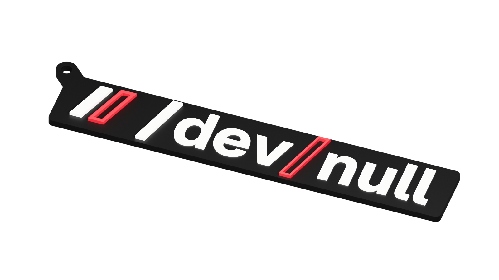

# /dev/null goodies

> Things you can print. Unlike everything else you send to /dev/null, they come back.

Unofficial, fan-made printable goodies based on the logo of [/dev/null](https://dev-null.sh), the open-source social
network where developers commit messages to the log ([source code](https://github.com/dev-null-sh/dev-null.sh)).

## Goodies

| Preview | Goodie | Description | Print it |
| --- | --- | --- | --- |
|  | [Keychains](keychains/) | The /dev/null logo, on your keys. | [Print it on MakerWorld](TODO(MakerWorld URL)) |

More goodies may land here later. Stickers and coasters are still in the staging area.

## Printing

- Each goodie ships a `.3mf` file with ready-to-print Bambu Studio plates and colors.
- Each goodie also has a `stl/` folder for other slicers, with one STL per object.

## Tooling

The STL files and the renders are generated from the `.3mf` projects. The tooling requires
[uv](https://docs.astral.sh/uv/), and the renders require [Blender](https://www.blender.org/) (found on the `PATH`, in
`/Applications` on macOS, or through the `BLENDER` environment variable).

```console
$ uv run scripts/export_stl.py keychains/keychains.3mf   # writes keychains/stl/<object>.stl
$ uv run scripts/render.py keychains/keychains.3mf       # writes keychains/images/<object>.png
$ uv run pytest
```

`render.py` accepts `--resolution WIDTHxHEIGHT` (default `1600x900`) and `--samples N` (default `128`).

Some goodies only show their look once sliced (e.g. coasters printed without top surface, so the infill pattern is
visible). For those, `--toolpaths` slices the project with [Bambu Studio](https://bambulab.com/en/download/studio)
(found on the `PATH`, in `/Applications` on macOS, or through the `BAMBU_STUDIO` environment variable) and renders the
G-code toolpaths, one image per plate:

```console
$ uv run scripts/render.py coasters/coasters.3mf --toolpaths
```

`--gcode DIR` renders already sliced `plate_N.gcode` files instead.

## Changelog

The changelog is the git history, and printable milestones are tagged as
[GitHub Releases](../../releases).

## Contributing

Remixes, new variants and photos of your prints are welcome: open an issue or a pull request.

Printed one? Commit it to the log on [/dev/null](https://dev-null.sh) and tag @jubianchi.

## License

The models are licensed under [CC BY-SA 4.0](LICENSE).

The /dev/null name and logo belong to the /dev/null project. This is an unofficial fan project, not affiliated with or
endorsed by it. The logo is used in line with the [/dev/null brand guidelines](https://dev-null.sh/brand).
