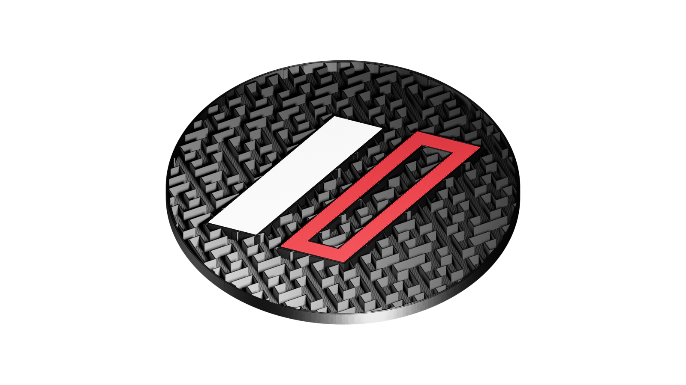

# /dev/null coaster

> Pipe your coffee to /dev/null. It won't leak.

[Print it on MakerWorld](TODO(MakerWorld URL))

The coaster is printed without top surface: the Hilbert curve infill stays visible and gives it its texture. The renders
are made from the sliced toolpaths, so they show what comes out of the printer.

## Variants

| Dark | Light |
| --- | --- |
|  |  |

## Files

| File | Description |
| --- | --- |
| `coasters.3mf` | Bambu Studio project: one plate per coaster, colors and per-part settings already assigned |
| `stl/*.stl` | One STL per coaster, for other slicers, generated from `coasters.3mf` |
| `images/*.png` | One render per coaster, generated from the sliced `coasters.3mf` |
| `MAKERWORLD.md` | Description posted on MakerWorld |

## Print settings

| Setting | Value |
| --- | --- |
| Profile | 0.20mm Standard @BBL H2S |
| Layer height | 0.2 mm |
| Top shell layers | 0 (coaster body only) |
| Infill | 10 % Hilbert curve (coaster body only) |
| Supports | None |
| Colors | 3 PLA (black `#131313`, red `#C42430`, white `#ECECEB`): AMS, or filament swaps |
| Size | Ø 120 mm, 5 mm thick |
| Print time | ~2 h, as estimated by Bambu Studio |
| Filament | ~48 g |

The top shell and infill settings only apply to the coaster body, the logo keeps a regular top surface. The STL files
merge the body and the logo into a single body, so they lose both the colors and these per-part settings: use the 3MF
for the intended look.
