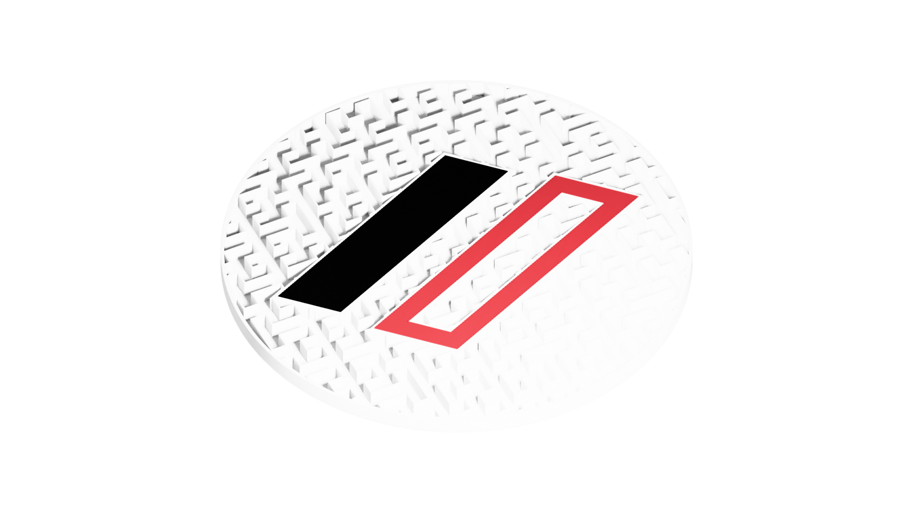

# /dev/null coaster

> Pipe your coffee to /dev/null. It won't leak.

<picture>
  <source media="(prefers-color-scheme: dark)" srcset="images/coaster-light.png">
  
</picture>

[Print it on MakerWorld](TODO(MakerWorld URL))

The coaster is printed without top surface: the Hilbert curve infill stays visible and gives it its texture. The renders
are made from the sliced toolpaths, so they show what comes out of the printer.

## Variants

| Dark | Light |
| --- | --- |
|  |  |

## Files

| File | Description |
| --- | --- |
| `coasters.3mf` | Bambu Studio project: 4 plates (see below), colors and per-part settings already assigned |
| `stl/*.stl` | One STL per coaster and filament, for other slicers, generated from `coasters.3mf` |
| `images/*.png` | One render per coaster, generated from the sliced `coasters.3mf` |
| `MAKERWORLD.md` | Description posted on MakerWorld |

## Plates

| Plate | Content |
| --- | --- |
| 1. `coaster-dark` | Dark coaster, printed in one piece |
| 2. `coaster-light` | Light coaster, printed in one piece |
| 3. `coaster-dark-multi` | Dark coaster in 3 pieces, to glue together |
| 4. `coaster-light-multi` | Light coaster in 3 pieces, to glue together |

The one-piece plates change filament on every layer of the logo, with a purge each time. The multi-piece plates print
the coaster body, with logo-shaped pockets, and the two logo slashes as separate single-color pieces. They use the
"by object" print sequence, so each piece is printed in full before the next one: only two filament changes per plate.
Once printed, glue the slashes into their pockets.

The STL files and the renders only cover plates 1 and 2:

```console
$ uv run scripts/export_stl.py coasters/coasters.3mf --skip-plate 3 --skip-plate 4
$ uv run scripts/render.py coasters/coasters.3mf --toolpaths --lighting side-low --skip-plate 3 --skip-plate 4
```

## Print settings

| Setting | Value |
| --- | --- |
| Profile | 0.20mm Standard @BBL H2S |
| Layer height | 0.2 mm |
| Top shell layers | 0 (coaster body only) |
| Infill | 10 % Hilbert curve (coaster body only) |
| Supports | None |
| Colors | 3 PLA (Basic black `#000000`, Matte red `#BB3D43`, Matte white `#FFFFFF`): AMS, or filament swaps |
| Size | Ø 120 mm, 5 mm thick |
| Print time | ~2 h in one piece, as estimated by Bambu Studio |
| Filament | ~55 g in one piece |

The top shell and infill settings only apply to the coaster body (`*-1-black.stl` for the dark coaster,
`*-3-white.stl` for the light one), the logo keeps a regular top surface. STL files cannot carry these per-part
settings: set them on the body part in your slicer, or use the 3MF.
