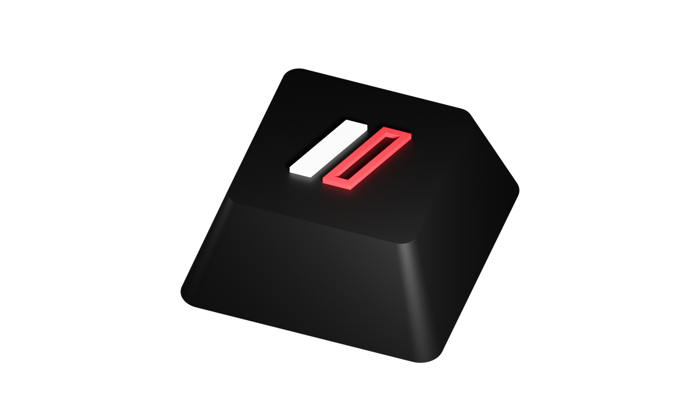
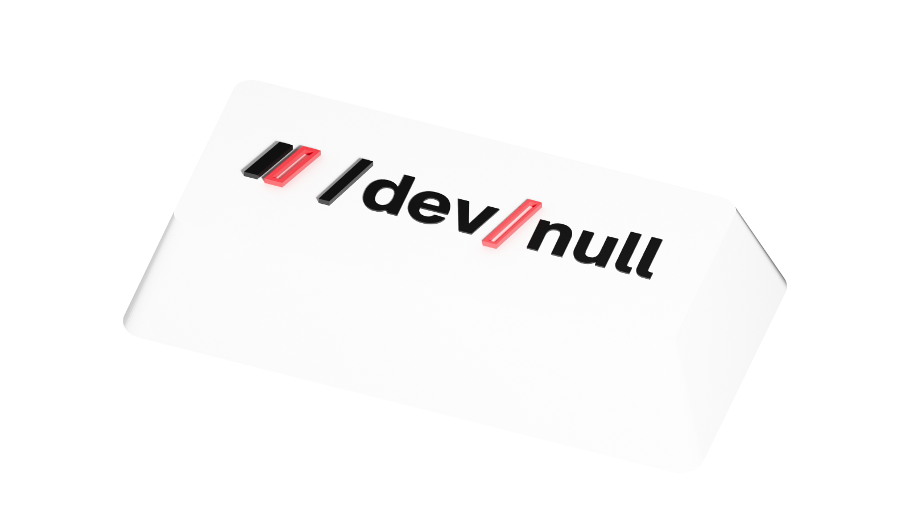
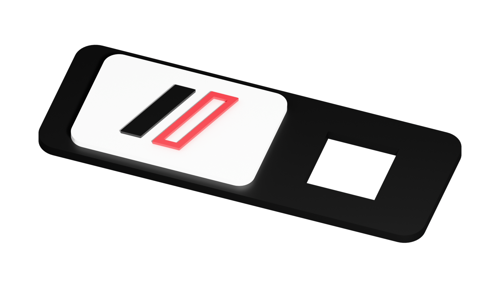

# Concepts

Mockups of goodie ideas, not printable models. Vote for the one you want next on its issue:

| Concept | Idea | Vote |
| --- | --- | --- |
|   | /dev/null keycap: 1u (e.g. Escape) and 2u (Backspace), dark or light | [#1](../../../issues/1) |
|  | /dev/null webcam cover | [#2](../../../issues/2) |
|  | /dev/null badge clip | [#3](../../../issues/3) |

The `stl/` folder holds the mockup geometry, one STL per concept and filament (`<concept>-<filament>-<color>.stl`), as a
starting point for modeling. These are not printable as is: the keycap has no stem, the badge clip has no clip
mechanism, and the webcam cover has no rail.
