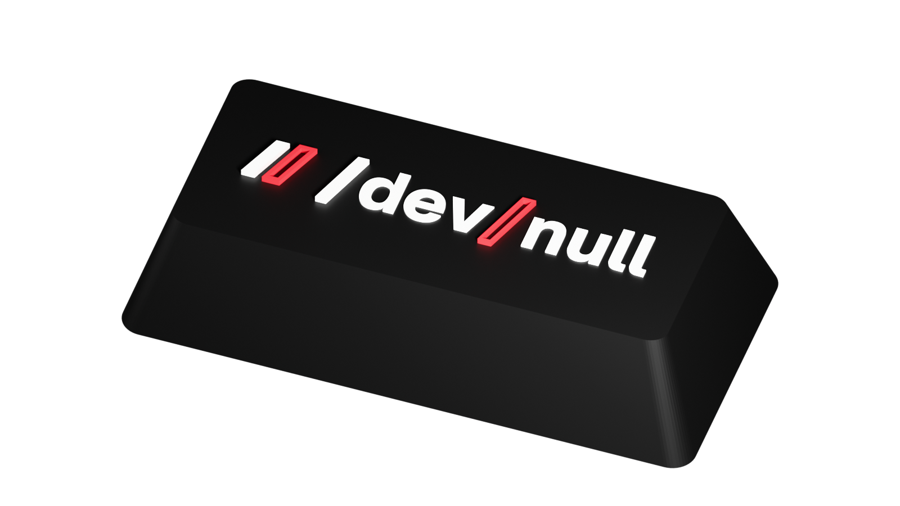
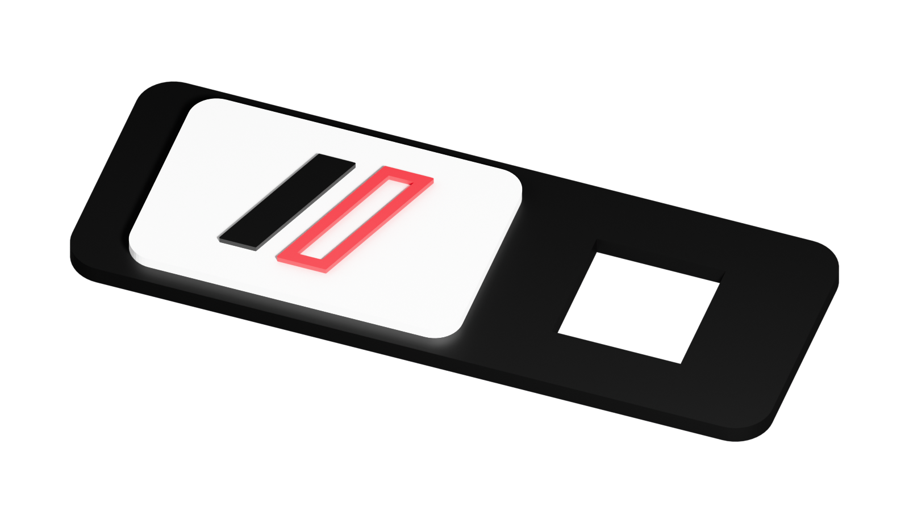
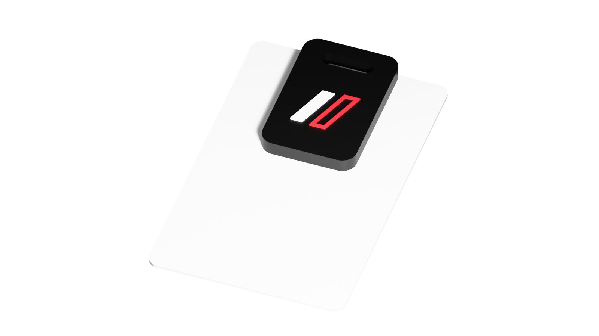
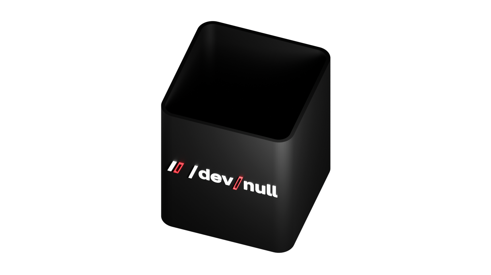
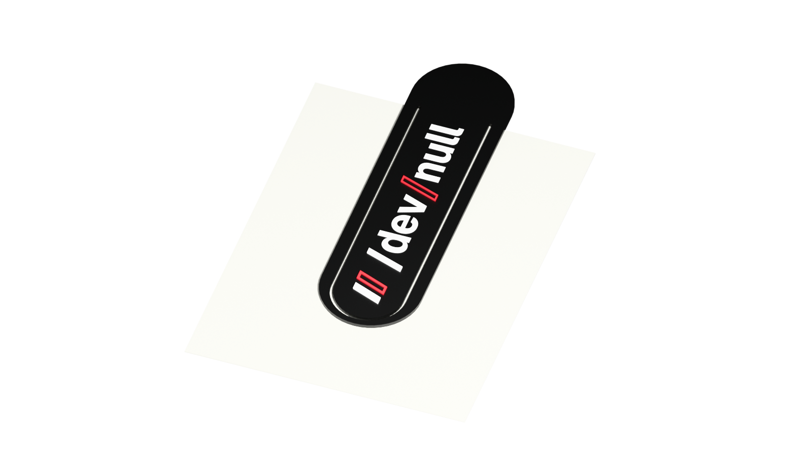

# Concepts

Mockups of goodie ideas, not printable models. Vote for the one you want next on its issue:

| Concept | Idea | Vote |
| --- | --- | --- |
| <picture><source media="(prefers-color-scheme: dark)" srcset="keycap-1u-light.png"></picture> <picture><source media="(prefers-color-scheme: dark)" srcset="keycap-2u-light.png"></picture> | /dev/null keycap: 1u (e.g. Escape) and 2u (Backspace), dark or light | [#1](../../../issues/1) |
| <picture><source media="(prefers-color-scheme: dark)" srcset="webcam-cover-light.png"></picture> | /dev/null webcam cover | [#2](../../../issues/2) |
| <picture><source media="(prefers-color-scheme: dark)" srcset="badge-clip-light.png"></picture> | /dev/null badge clip | [#3](../../../issues/3) |
| <picture><source media="(prefers-color-scheme: dark)" srcset="desk-bin-light.png"></picture> | /dev/null desk bin | [#4](../../../issues/4) |
| <picture><source media="(prefers-color-scheme: dark)" srcset="bookmark-light.png"></picture> | /dev/null bookmark: a flat clip with a U-shaped slit that grips the page | [#5](../../../issues/5) |

Each concept comes in a dark and a light variant (`<concept>-dark.png`, `<concept>-light.png`): the light one shows on
a dark theme, the dark one on a light theme.

The `stl/` folder holds the mockup geometry, one STL per concept, variant and filament
(`<concept>-<variant>-<filament>-<color>.stl`), as a starting point for modeling. These are not printable as is: the
keycap has no stem, the badge clip has no clip mechanism, the webcam cover has no rail, and the desk bin and the
bookmark have not been tuned for printing.
