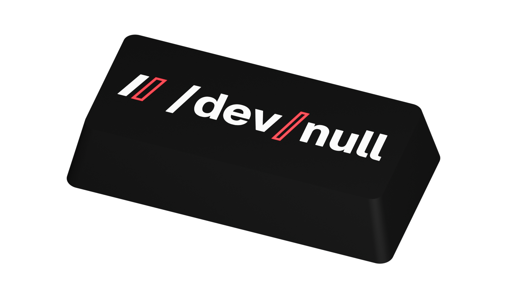
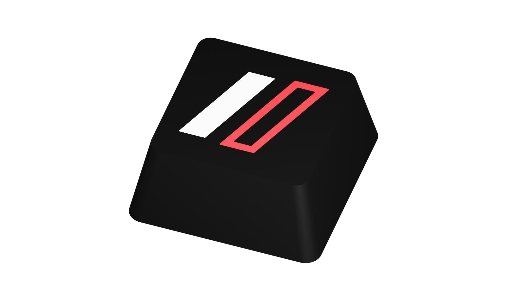
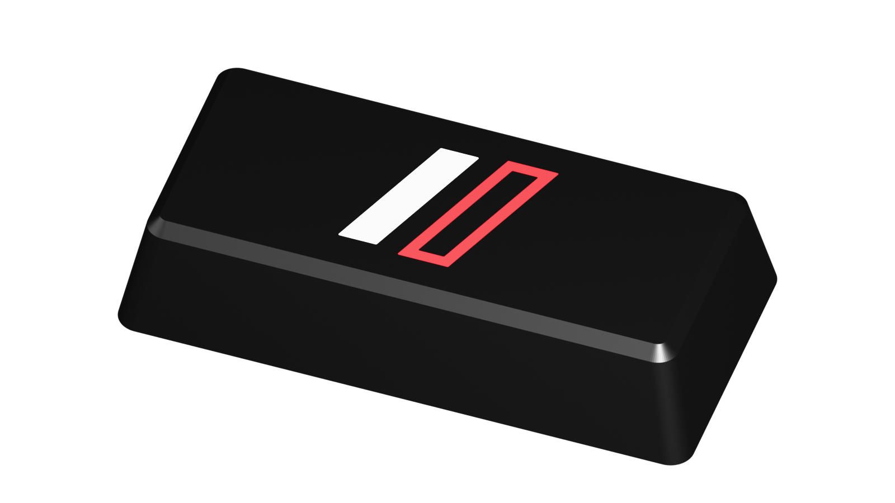
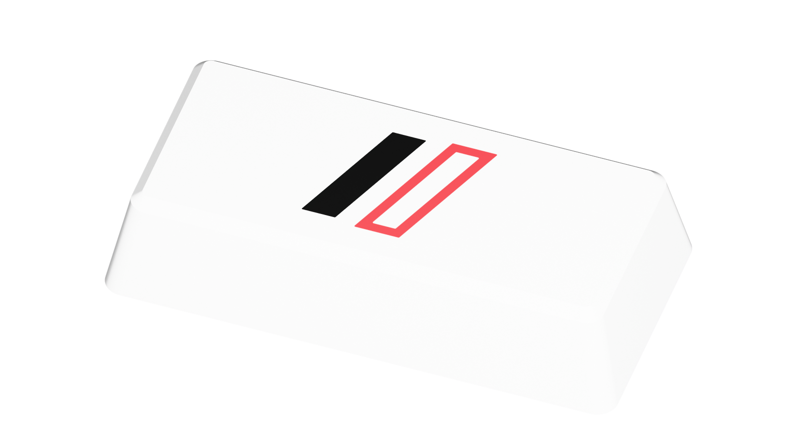

# /dev/null keycap

> Your Escape and Backspace keys never felt so honest.

<picture>
  <source media="(prefers-color-scheme: dark)" srcset="images/keycap-2u-light.png">
  
</picture>

[Print it on MakerWorld](TODO(MakerWorld URL))

Cherry MX compatible keycaps with the /dev/null logo inlaid in color in a flat top. They are printed upside down, top
face on the build plate: the logo is part of the first layers, so it stays sharp and never wears off.

## Variants

| | Dark | Light |
| --- | --- | --- |
| 1u (e.g. Escape), /dev/null mark |  |  |
| 2u (Backspace), mark and wordmark |  |  |
| 2u (Backspace), mark only |  |  |

## Files

| File | Description |
| --- | --- |
| `stl/keycap-<size>-<variant>-<filament>-<color>.stl` | One STL per keycap and filament, generated by `scripts/keycap.py` |
| `stl/keycap-clearance-coupon-1-black.stl` | Clearance test coupon, see [Fit](#fit) |
| `MAKERWORLD.md` | Description posted on MakerWorld |

Unlike the other goodies, the keycaps are modeled in code: `scripts/keycap.py` builds them and takes the logo from the
keychains (`keychains/keychains.3mf`), so both always match.

```console
$ uv run scripts/keycap.py                    # writes keycaps/stl/*.stl
$ uv run scripts/keycap.py --clearance 0.1    # looser stems, see Fit
```

The renders turn the keycaps over and leave the clearance coupon (plate 5) out:

```console
$ uv run scripts/render.py keycaps/keycaps.3mf --flip --skip-plate 5 --lighting far
```

## Dimensions

| | 1u | 2u |
| --- | --- | --- |
| Base | 18.2 × 18.2 mm | 37.25 × 18.2 mm |
| Top | 13.7 × 13.7 mm, flat, with a 0.8 mm chamfer | 32.8 × 13.7 mm, flat, with a 0.8 mm chamfer |
| Height | 8 mm, the same on every row | 8 mm, the same on every row |
| Stems | 1 Cherry MX cross | 1 Cherry MX cross and 2 Cherry stabilizer crosses, 23.876 mm apart |
| Logo | Mark, 11 × 9.75 mm, inlaid 0.6 mm deep | Mark and wordmark, 30 × 4.9 mm, or mark only, 11 × 9.75 mm, inlaid 0.6 mm deep |

The 2u mark and wordmark are so small that the red outlined slashes are thickened inward to 0.3 mm, keeping their outer
shape: they need a 0.2 mm nozzle. The 1u and the 2u with the mark only print with a 0.4 mm nozzle.

## Fit

How tight a printed stem grips the switch depends on the printer, the filament and the settings. Print the clearance
coupon first, with the same settings as the keycaps: it has five stems, marked with 1 to 5 notches.

| Notches | Clearance per side | Cross |
| --- | --- | --- |
| 1 | 0 mm | 4.00 × 1.17 mm |
| 2 | 0.05 mm (default) | 4.10 × 1.27 mm |
| 3 | 0.10 mm | 4.20 × 1.37 mm |
| 4 | 0.15 mm | 4.30 × 1.47 mm |
| 5 | 0.20 mm | 4.40 × 1.57 mm |

Push each one on a switch and keep the tightest that goes on without forcing and does not wobble, then generate the
keycaps with that clearance (`--clearance`). Too tight, it can crack the switch stem; too loose, the keycap falls off.

## Assembling

Import the STLs of a keycap together as parts of a single object and assign each one its filament: they share the same
origin, so they line up. Keep them as they are, top face on the build plate: no supports needed.

## Print settings

TODO(print settings validated with a test print)
