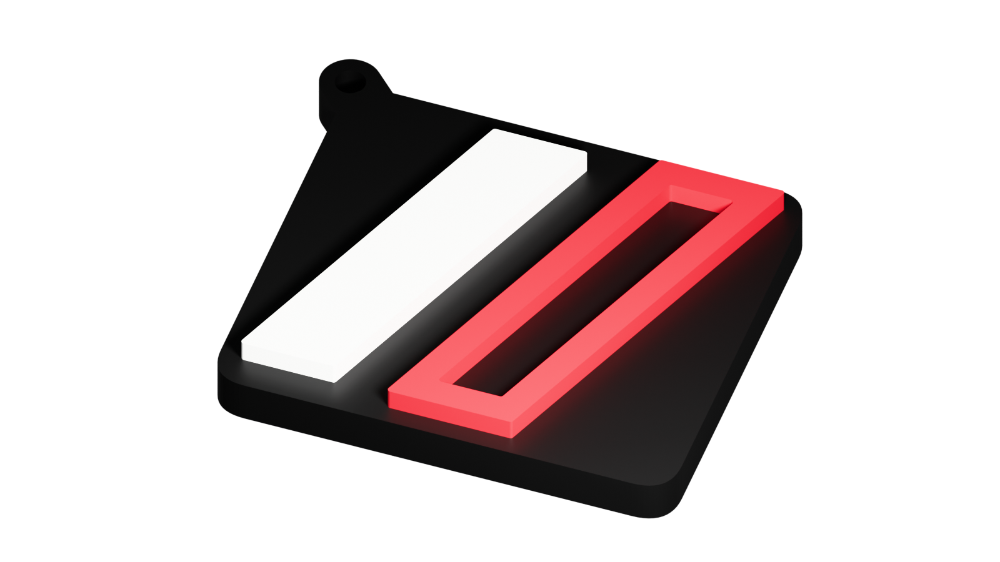

# /dev/null keychain

> Everything you write to /dev/null disappears. Your keys won't.

[Print it on MakerWorld](TODO(MakerWorld URL))

## Variants

| | Dark | Light |
| --- | --- | --- |
| Large |  |  |
| Small |  |  |

## Files

| File | Description |
| --- | --- |
| `keychains.3mf` | Bambu Studio project: one plate per keychain, colors already assigned |
| `stl/*.stl` | One STL per keychain, for other slicers, generated from `keychains.3mf` |
| `images/*.png` | One render per keychain, generated from `keychains.3mf` |
| `MAKERWORLD.md` | Description posted on MakerWorld |

## Print settings

| Setting | Value |
| --- | --- |
| Profile | 0.20mm Standard @BBL H2S |
| Layer height | 0.2 mm |
| Infill | 15 % |
| Supports | None |
| Colors | 3 PLA (black `#131313`, red `#C42430`, white `#ECECEB`): AMS, or filament swaps |
| Print time | ~42 min (large), ~28 min (small), as estimated by Bambu Studio |
| Filament | ~12.5 g (large), ~8.3 g (small) |

## Photos

Community prints will show up here. Send yours through an issue or a pull request.

<!-- TODO(add community print photos in keychains/images/) -->
